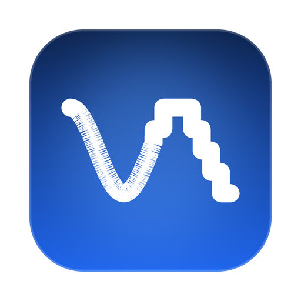

# CodecBlue

**Hi-res Bluetooth audio for the Mac.** CodecBlue streams your Mac's audio to Bluetooth
headphones in **LDAC**, using the Mac's built-in Bluetooth. No dongle, no SIP changes, no
kernel extensions, no root daemon — and no proprietary app deciding which codec you get.

> **Status: LDAC works end to end, from the Mac's own output.** Pick the **CodecBlue** output
> device and every app plays through it in LDAC — no root, no kernel extension, no daemon.
> Measured on 2026-11-07 with Huawei FreeBuds 5 on a MacBook's built-in controller: 336 kbps
> of LDAC, 0% of audio dropped, 0 skips, cushion 40 ms, ~60 ms of latency added by this
> program, verified by ear.
>
> The level is not a switch between three names. libldac has **five** bitrates — 990, 660,
> 492, 396 and 330 kbps at 48 kHz — and Sony named only three of them. CodecBlue measures what
> the link carries and picks the highest rung that fits in 85% of it, because on a link that
> carries ~530 kbps, 660 throws away a third of the audio and 330 leaves half the bitrate on
> the table. `codecblue levels` shows the ladder and what fits here.
>
> Three findings did most of the work, and each is written up with its measurements in
> `notes/findings/2026-11-05-play-ldac-queue.md`:
>
> - the throughput ceiling was the controller's **A2DP link quality mode**, which `bluetoothd`
>   only enables when it believes it is streaming (§13.1);
> - the crackle was the virtual device declaring a **one-second clock period**, so the host
>   corrected clock drift once a second, in one audible step (§13.15);
> - the skips were the packet queue discarding the **front** of the cushion instead of the
>   back, so the stall that caused the overflow found nothing to play (§13.13).
>
> The ceiling of ~500 kbps on this machine is a controller limit: it never negotiates 3-slot
> packets (`Link Adaptive Packet type support = 0`) and macOS does not expose
> `HCISetACLPacketType`. LDAC HQ at 990 kbps is therefore not reachable here, and that is a
> property of the hardware, not of this program — which is why the level is chosen from the
> measured bitrate instead of from a preference.

## How it works

macOS only offers SBC and AAC to Bluetooth headphones. CodecBlue leaves Bluetooth to macOS
and takes over **only your headphones' audio channels**:

1. It asks `bluetoothd` (through its classic Bluetooth XPC service) for the headphones'
   A2DP signaling and media channels, and for their remote-control (AVRCP) channel.
2. It negotiates the codec itself (AVDTP) and streams audio encoded with **LDAC**. aptX, AAC
   and SBC are the plan, not a claim: a pair of headphones that offers no LDAC endpoint gets an
   error that says so, instead of a configuration puzzle.
3. Audio comes from a **CodecBlue virtual output device**: pick it like any other output.
4. **Calls need a hand, for now.** CodecBlue holds the headphones' hands-free channel and
   refuses calls on it, so a call app cannot quietly open a SCO link and starve the stream.
   The hand-back itself is not automatic yet: `codecblue release ADDR` drops the link and
   lets macOS reconnect, and starting the stream again takes the headphones back. Automatic
   hand-off during a call is the next thing to build.

Keyboards, mice and every other Bluetooth device stay with macOS and keep working.

Requirements: Apple Silicon, macOS 14.2 or later. Built and tested on macOS 27 with the
Command Line Tools alone — no full Xcode.

> ⚠️ CodecBlue relies on **private macOS interfaces**. A macOS update can break it; when
> that happens, the headphones simply fall back to macOS.

## Building

Requirements: Xcode Command Line Tools (Swift 6). Full Xcode is not needed.

```sh
git clone --recurse-submodules https://github.com/PaoloAlbano/CodecBlue.git
cd CodecBlue
make check                         # format + lint + build + tests (what CI runs)
.build/debug/codecblue version
.build/debug/codecblue lookup AA:BB:CC:DD:EE:FF   # what bluetoothd knows about your headphones
.build/debug/codecblue probe  AA:BB:CC:DD:EE:FF   # list the codecs they support (takes them for a few seconds)
```

## Installing

One command installs everything:

```sh
./scripts/install.sh
```

It builds, then puts three pieces where they belong, and asks for `sudo` once:

| Where | What | Why there |
|---|---|---|
| `/Library/Audio/Plug-Ins/HAL/CodecBlueDriver.driver` | the virtual output device | the audio system owns that folder, and loads it on every boot |
| `~/Applications/CodecBlue/` | `codecblue`, `codecblue-keys`, `CodecBlue.app` | no `sudo`, and it survives `swift package clean` |
| `~/Library/LaunchAgents/com.codecblue.system.plist` | the agent that keeps audio flowing | written by the app when you pick a pair of headphones |

Installing only the driver is the mistake this script exists to prevent: the device appears,
every app plays into it, and nothing feeds it, so the result is silence with no error anywhere.

`./scripts/install.sh --uninstall` removes all three.

## Using it

Open **CodecBlue** from `~/Applications/CodecBlue/` (or run `open ~/Applications/CodecBlue/CodecBlue.app`).
It lives in the menu bar: pick your headphones, press **Start streaming**, and every app now
plays through them in LDAC. Closing the window does not stop the music — the agent owns the
stream, and brings it back when the headphones do.

From the menu you can also change the LDAC level while it plays — the whole ladder, with the
rung this link would actually use ticked — and the device's sample rate.

From a terminal, the same things:

```sh
codecblue devices                # the headphones macOS knows, and whether they are on
codecblue status                 # what a running stream is doing
codecblue quality HQ             # the ceiling: as good as this link allows, up to HQ
codecblue quality 2              # or a rung with no name: 492 kbps
codecblue adapt on               # or let it choose the level itself
codecblue levels                 # the whole ladder, and what fits here
codecblue compare                # this link against the Mac's own AAC
codecblue rate 44100             # the device's rate; applies after `sudo killall coreaudiod`
```

Without the app, the stream can also be run by hand:

```sh
./codecblue system AA:BB:CC:DD:EE:FF --quality LQ
```

`Ctrl-C` stops cleanly and hands the headphones back to macOS.

| Command | What it does |
|---|---|
| `codecblue system ADDR` | Stream the Mac's output to the headphones (the real use) |
| `codecblue play ADDR FILE` | Stream a file, for testing without the driver |
| `codecblue flood ADDR SECS BYTES` | Measure the link's throughput |
| `codecblue tone FILE SECS [--sweep]` | Write a test signal: a constant sine, or a sweep |
| `codecblue devices` | The headphones macOS knows, and whether they are on |
| `codecblue status` | What a running stream is doing |
| `codecblue levels` | The whole ladder, and what fits on this link |
| `codecblue compare` | This link against the Mac's own AAC, in kbps |
| `codecblue quality HQ\|SQ\|LQ\|0-4` | The ceiling, while it plays. A level is a limit, not a resting place |
| `codecblue adapt on\|off` | Let it choose the level itself |
| `codecblue cushion 40` | The cushion in ms — this is the latency |
| `codecblue rate 44100\|48000` | The device's sample rate (after a coreaudiod restart) |
| `codecblue abr` | What this libldac build accepts, measured rather than assumed |
| `codecblue agent install\|remove\|status` | The LaunchAgent |
| `codecblue handlers device\|general` | Which handler answers each known message |

Options for `system` and `play`: `--quality HQ|SQ|LQ|0-4` (the ceiling of the ladder),
`--queue-ms` (the cushion, and therefore the latency), `--adapt`, `--keep-link-quality`,
`--sndbuf-packets`, `--gain`.

**Test signals matter.** `codecblue tone` writes a constant sine, not a melody: a file whose
notes change has phase jumps at every change, and a phase jump is exactly what a codec makes
worse. Testing a link with such a file tests the file. This cost a day.

## Repository layout

| Path | Contents |
|---|---|
| `Package.swift` | Swift package (SwiftPM) |
| `Sources/CodecBlueCore/` | Engine: bluetoothd channel broker, AVDTP/AVRCP, codecs, session state machine |
| `Sources/codecblue/` | Command-line tool |
| `Sources/codecblue-keys/` | Media key helper — the only binary that needs Accessibility permission |
| `Sources/CodecBlueMenu/` | The menu bar app: a client of the control channel, no audio code |
| `Sources/codecblue-selftest/` | Unit tests (run with `make test`) |
| `Driver/CodecBlueDriver/` | The virtual output device (a C AudioServerPlugIn) |
| `scripts/build-driver.sh` | Builds the driver, and installs or removes it with `--install` / `--uninstall` |
| `scripts/build-menu-app.sh` | Assembles `CodecBlueMenu.app` (a bundle is needed for `LSUIElement`) |
| `scripts/install.sh` | Installs all three pieces, or removes them with `--uninstall` |
| `Makefile` | `make check` is the gate CI runs; `make format` rewrites the sources |
| `notes/findings/` | What was measured and what it proved, including the dead ends |
| `third_party/libldac/` | AOSP libldac (git submodule, unmodified) |

Only LDAC is implemented. aptX, AAC and SBC are the plan, not a claim: headphones that do not
offer an LDAC endpoint cannot be driven by this yet, and the error says so explicitly rather
than looking like a configuration problem.

The menu bar app is a thin client: everything it shows comes from the list of headphones macOS
knows and from the control channel of a running stream, and everything it does is write the
LaunchAgent, load it, or send a line down that channel. There is no audio code in it and no
second copy of the rules — a second copy is a second thing to keep correct.

## Acknowledgements

CodecBlue builds on what [Blue Bloom](https://github.com/jonathanlu98/bluebloom) (MIT)
learned about bluetoothd's XPC interface and about taking headphones over from macOS.
See [THIRD_PARTY_NOTICES.md](THIRD_PARTY_NOTICES.md).

## Contributing

See [CONTRIBUTING.md](CONTRIBUTING.md). If you use an AI coding agent, point it at
[AGENTS.md](AGENTS.md).

## License

[MIT](LICENSE). Third-party components are listed in
[THIRD_PARTY_NOTICES.md](THIRD_PARTY_NOTICES.md).

CodecBlue is an independent open-source project. LDAC is a trademark of Sony Corporation;
aptX is a trademark of Qualcomm Technologies, Inc.; Bluetooth is a registered trademark of
Bluetooth SIG, Inc. This project is not affiliated with or endorsed by them; the names are
used only to describe codec compatibility.
